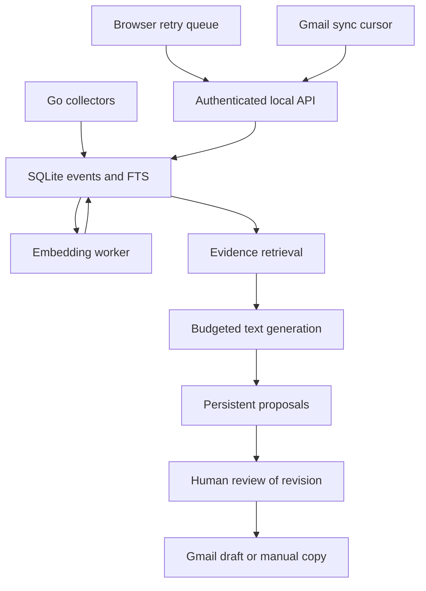

# Architecture

Qareen uses deterministic orchestration around bounded LLM calls. A continuously reasoning agent would still incur model calls, and would make retries and approval harder to reason about.

SQLite is authoritative for events and their chunk vectors. There is no second mutable FAISS event store to resurrect deleted records or lose interleaved insertions. Optional documentation uses a separately built, trusted local FAISS index. The service never accepts an index path over HTTP.

Events separate `source_event_id`, account, conversation, actor, action, direction, source time, ingestion time, and metadata. New timestamps use UTC. Legacy times remain marked until the operator supplies their original timezone. Stable source identifiers make delivery at least once and ingestion idempotent. Streaming messages update the existing event and invalidate its vector and dependent proposals.

Collectors persist before enrichment. Failed SQL writes use a bounded private disk outbox. Embedding failures record retry state in SQLite; capture can continue while model download or inference is unavailable. The warm CPU model is serialized, and embedding work happens outside the event-store lock.

Retrieval applies structured source/app/time filters. Keyword candidates use FTS5, vector candidates use normalized chunk embeddings, and reciprocal-rank fusion combines them. Scores represent ranking, not certainty. Temporal summaries sample across the entire interval and report omitted events. “Yesterday” is a half-open calendar interval in the configured timezone. Morning means 06:00–12:00, afternoon 12:00–18:00, evening 18:00–22:00, and night 22:00–24:00.

Jobs have durable pending/running/retry/done/failed states and a lease. New eligible mail and deduplicated errors can trigger proposals when enabled. Retries reconcile existing proposals before generating again. Budgets count attempted cloud calls, including failures, by UTC day. This is not a dollar-cost estimator; token and latency counters are exposed.

Proposal states are proposed, approved, rejected, expired, and exported. Editing increments the revision and returns to proposed. Approval and export require the reviewed revision and unchanged evidence. Conversation updates invalidate earlier pending approvals. Export stores a Gmail draft ID; a timeout creates an unknown state and subsequent requests reconcile the unique Message-ID instead of blindly repeating a POST. A remote mailbox change can still occur after the last preflight check; Gmail offers no atomic compare-and-create transaction here. Review the resulting draft before sending it yourself.

No model function can send mail, post to WhatsApp, execute shell text, or select an arbitrary network destination. The only external write path is the ordinary application's authenticated, approved Gmail draft exporter.
